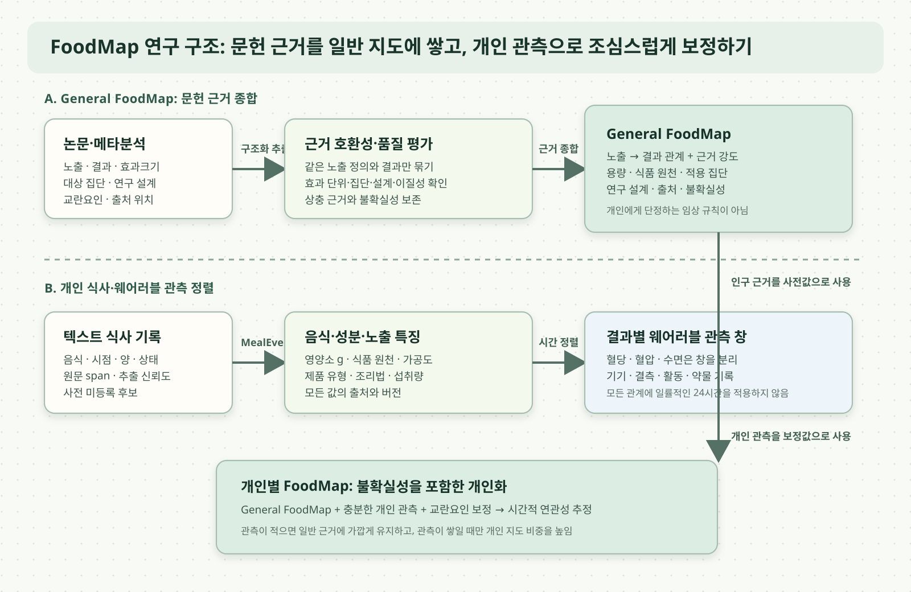

# FoodMap 연구 구조와 알고리즘 선택



## 연구 목표에 맞는 데이터 흐름

FoodMap의 목표는 논문 수를 단순 가중 평균해 건강 점수를 만드는 것이 아니다.
서로 비교 가능한 문헌 근거를 General FoodMap에 축적하고, 이후 개인의 식사와
건강 관측이 충분할 때만 개인별 지도를 조심스럽게 보정하는 것이다.

```text
문헌 근거 -> General FoodMap -> 개인화의 사전값
텍스트 식사 기록 -> 음식·시점·양·상태 -> 음식 성분·노출 특징
웨어러블 측정 -> 결과별 사전 정의 관측 창 -> 개인 관측 연관성
General FoodMap + 개인 관측 -> 개인별 FoodMap
```

`24시간`은 편리한 기본값이지만 연구 규칙으로 쓰면 안 된다. 예를 들어 식후
혈당, 나트륨과 혈압, 늦은 카페인과 수면은 서로 다른 관측 창과 측정 장비가
필요하다. 각 노출-결과 관계는 분석 전에 관측 창, 포함·제외 기준, 교란요인을
프로토콜로 고정한다.

## 더 좋은 알고리즘은 무엇인가

### 1. 논문 데이터 추출: 스키마 제약 LLM + 사람 검토

처음부터 논문 전체를 벡터 검색 후 자유롭게 요약하는 방식은 근거 수치와
조건을 빠뜨리거나 섞을 위험이 크다. 대신 JSON 스키마를 강제한 LLM 추출을
권장한다. 한 관계마다 노출, 단위, 비교군, 결과, 효과크기, 신뢰구간, 대상 집단,
연구 설계, 교란요인, 근거 문장 또는 표 위치를 별도 필드로 요구한다.

초기 핵심 논문 8편은 사람이 같은 스키마로 이중 검토해 gold set을 만든다.
LLM은 이 gold set과 비교해 필드별 정확도와 근거 위치 재현율을 측정한 뒤에만
대량 논문으로 확장한다. 수치·단위·DOI 검증은 코드로 하고, 노출 의미의 일치와
연구 설계 해석은 사람이 판정한다.

### 2. General FoodMap 종합: 관계 키 + 계층적 메타분석

단순 가중 평균보다 먼저 아래 관계 키가 완전히 같거나 호환되는지 확인한다.

```text
exposure_definition + unit + comparator + outcome_definition
+ population + follow_up_window + study_design
```

키가 다른 연구는 같은 `sugar` 아래에 보관하되 같은 효과 추정치로 합치지 않는다.
키가 호환되고 효과 지표도 비교 가능할 때는 random-effects보다 한 단계 확장된
**베이지안 계층적 메타분석**을 장기 목표 알고리즘으로 둔다. 연구별 효과와
이질성을 함께 추정하고, 효과크기 하나가 아니라 불확실성 구간을 General
FoodMap에 저장할 수 있기 때문이다.

초기에는 논문 수와 효과 정의가 적으므로 메타분석을 억지로 수행하지 않는다.
먼저 근거 그래프와 품질·호환성 점수를 저장하고, 동일 관계에 충분한 연구가
쌓인 경우에만 종합한다. OR, RR, HR, 평균 차이처럼 측도가 다른 효과를 검증
없이 서로 변환하거나 평균내면 안 된다.

### 3. 텍스트 식사 기록: 규칙 기반 정규화 + 구조화 추출

현재 단계에서는 음식 사전과 별칭을 이용한 규칙 기반 정규화에, 구조화 LLM
추출을 보조로 결합하는 하이브리드 방식이 적합하다. 음식 ID, 단위, 시간 표현,
부정 섭취 같은 반복적이고 검증 가능한 부분은 규칙으로 처리해 결과를 안정시킨다.
문맥 의존 표현과 새 음식 후보는 LLM이 JSON 후보로 제안하되, 낮은 신뢰도와
사전 미등록 항목은 자동 확정하지 않는다.

라벨된 독립 코퍼스가 수백~수천 문장으로 커진 뒤에는 한국어 토큰 분류 모델이나
소형 instruction-tuned 모델을 후보로 비교한다. 이 시점에만 규칙 기반, LLM,
학습 모델의 음식·시간·양·상태 F1과 오류 유형을 같은 테스트셋에서 비교한다.

### 4. 개인 관측: 결과별 event study + 부분 풀링

개인 데이터에는 "식사 이후 24시간 평균" 하나보다 결과별 event study가 적합하다.
식사 이벤트 전후에 사전 정의한 특징을 계산하고, 활동·수면·약물·기저 상태·다른
식사 같은 교란요인을 함께 기록한다. 관측이 충분하면 distributed-lag model처럼
시간 지연 효과를 표현하는 모델도 검토할 수 있다.

개인별 관측이 적을 때는 General FoodMap을 사전값으로 쓰는 베이지안 부분 풀링
또는 현재의 경험적 베이즈 shrinkage가 적합하다. 한두 번의 이상치가 개인의
FoodMap을 바꾸지 않으면서, 반복 관측이 쌓이면 개인 데이터의 비중을 늘릴 수
있다. 이 단계의 출력은 기본적으로 시간적 연관성 추정이며, 인과 효과 선언이
아니다.

## 단계별 선택 기준

| 문제 | 지금 선택 | 데이터가 커졌을 때 | 이 선택의 이유 |
| --- | --- | --- | --- |
| 논문 정보 추출 | 스키마 제약 LLM + 사람 검토 | gold set 기반 반자동 추출 | 초기에는 정확도와 출처 위치가 속도보다 중요하다. |
| 문헌 종합 | 관계 키와 근거 그래프 | 베이지안 계층적 메타분석 | 이질적인 연구를 성급하게 평균내지 않는다. |
| 음식 텍스트 추출 | 사전·규칙 + 구조화 LLM | 학습 모델과 앙상블 비교 | 소규모 사전은 결정론적 규칙이 검증과 수정에 유리하다. |
| 개인 건강 연관성 | 결과별 event study + shrinkage | distributed-lag 또는 혼합효과 모델 | 시간 지연과 반복 측정을 보존하면서 과적합을 줄인다. |
| 데이터 저장 | JSONL 원본 + Parquet 분석본 + DuckDB | PostgreSQL/warehouse, 필요 시 그래프 DB | 현재는 로컬 조인·감사가 단순하고 비용이 낮다. |

## 검증 지표

1. 논문 추출: 필드별 precision, recall, 수치·단위 정확도, 근거 문장 위치 정확도.
2. 근거 종합: 같은 관계로 묶인 연구의 호환성 검토율, 보류 사유 기록률,
   상충 근거 노출률.
3. 텍스트 추출: 음식·시간·양·상태별 F1, 미등록 후보의 오확정률.
4. 개인화: 사전 등록한 관측 창에서의 재현성, 개인 내 반복 관측 안정성,
   누락·교란요인에 대한 민감도 분석.

이 지표를 먼저 정의하면 모델이 화려해져도 연구의 신뢰도가 낮아지는 상황을
피할 수 있다.
